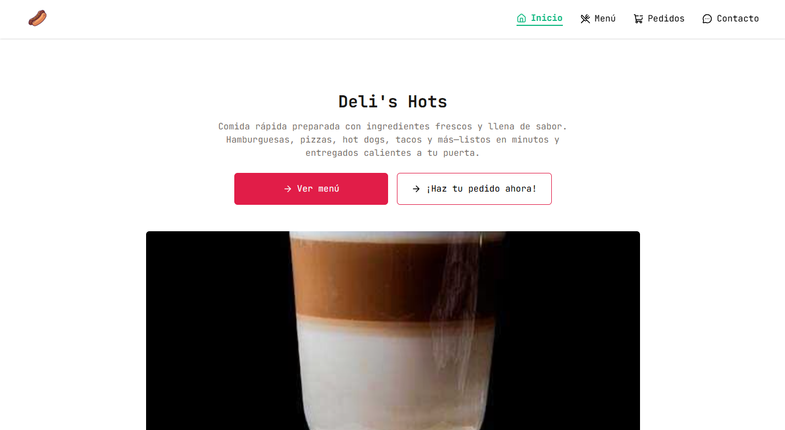

# Deli's Hots

[](https://github.com/14BryanEspinoza/deli-hots/actions/workflows/deploy.yml)
[](https://github.com/14BryanEspinoza/deli-hots/actions/workflows/ci.yml)
[](LICENSE)

> Landing page y página de pedidos del restaurante de comida rápida **Deli's Hots**, construida con **Astro 7** (SSG + islas de React) y **Tailwind CSS v4**. El catálogo se consume de una API REST en tiempo de build —validado con **Zod**—, el formulario de pedidos se envía vía **FormSubmit** y el sitio se despliega automáticamente en GitHub Pages.



---

## 🌐 Demo en vivo

**<https://14bryanespinoza.github.io/deli-hots/>**

---

## 🚀 Inicio rápido

```bash
pnpm install   # instalar dependencias
pnpm dev       # desarrollo local → http://localhost:4321/deli-hots/
pnpm preview   # previsualizar el build
```

**Verificación** — los cuatro checks deben pasar en `0`:

```bash
pnpm format:check   # Prettier
pnpm lint           # ESLint
pnpm check          # Astro check (TypeScript)
pnpm build          # Build de producción
```

> **Node requerido:** ≥ 22.12.0 (`engines` en `package.json` y workflow CI).

---

## 🗺️ Rutas

| Ruta        | Página  | Contenido                                                                     |
| ----------- | ------- | ----------------------------------------------------------------------------- |
| `/`         | Inicio  | Hero con carrusel, propuesta de valor y destacados (1 producto por categoría) |
| `/menu/`    | Menú    | Catálogo completo del restaurante                                             |
| `/orders/`  | Pedido  | Formulario de pedido con productos dinámicos desde la API                     |
| `/gracias/` | Gracias | Confirmación tras enviar el formulario                                        |

---

## ✨ Características

- **Astro 7 (SSG)** — HTML estático por página con View Transitions (`<ClientRouter />`).
- **React 19 + Embla Carousel** — única isla de React: carrusel con autoplay, loop, navegación táctil y **botón de pausa**.
- **Tailwind CSS v4 (CSS-first)** — configuración vía `@theme` con design tokens y tipografía monospace personalizados.
- **API REST en build time** — catálogo de `https://devsapihub.com/api-fast-food` consultado al construir y validado con **Zod**: si la API cambia de esquema o responde mal, el build falla en vez de publicar un menú vacío.
- **Selección por criterio** — `pickFeatured` (destacados: 1 producto por categoría) y `pickCarousel` (round-robin para el carrusel) en `src/lib/selection.ts`, sin índices mágicos.
- **Formulario de pedidos sin backend** — POST a [FormSubmit.co](https://formsubmit.co) que llega al correo del restaurante y redirige a `/gracias/`.
- **Contenido íntegramente en español neutro** (`lang="es"`): copy, `alt`, `aria-label`, títulos y meta tags.
- **Imágenes optimizadas en build** — `astro:assets` + Sharp con variantes AVIF/WebP y `srcset` responsive; la primera imagen carga con prioridad.
- **SEO por página** — `canonical` y Open Graph propios de cada ruta, más `@astrojs/sitemap` y `robots.txt`.
- **Iconos** — astro-icon con Lucide y Simple Icons.
- **Calidad de código** — TypeScript strict, ESLint + Prettier, Husky + lint-staged y CI en cada push/PR.

---

## 📁 Estructura del proyecto

```text
src/
├── components/          # Componentes reutilizables (Cards, Carousel, Form, Input, Link, Navbar, Products)
├── data/                # Datos estructurados y enlaces (features.ts, links.ts)
├── layouts/             # Secciones y layouts (Layouts, Hero, Features, Gallery, Footer)
├── lib/                 # Lógica de datos: api.ts (fetch + Zod), selection.ts, images.ts
├── metadata/            # Configuración SEO y Open Graph (metadata.ts)
├── pages/               # Rutas (index, menu, orders, gracias)
└── styles/              # Estilos globales y tokens de diseño (global.css)
public/
├── favicon.png
└── preview.png          # Imagen Open Graph / Twitter Card
```

---

## 🛠️ Comandos

```bash
# Instalar dependencias (pnpm)
pnpm install

# Desarrollo local (http://localhost:4321/deli-hots/)
pnpm dev

# Build de producción (genera dist/)
pnpm build

# Preview del build local
pnpm preview

# Lint + solución automática
pnpm lint
pnpm lint:fix

# Formato
pnpm format
pnpm format:check

# Verificación de tipos TypeScript y Astro
pnpm check
```

---

## 🌐 Despliegue

- **CI** (`.github/workflows/ci.yml`) — lint, formato, typecheck y build en cada push y PR a cualquier rama.
- **Deploy** (`.github/workflows/deploy.yml`) — en push a `main`:

1. **Job `build`** — `withastro/action@v6` (Node 22) → `pnpm install` + `pnpm build` → sube `dist/` como artifact.
2. **Job `deploy`** — `actions/deploy-pages@v4` → publica el artifact en el entorno `github-pages`.

URL final: **<https://14bryanespinoza.github.io/deli-hots/>**

> La configuración de base path en `astro.config.mjs`:

```js
{
  site: "https://14bryanespinoza.github.io/deli-hots/",
  base: "/deli-hots/",
  build: { assets: "assets" }
}
```

---

## 🧱 Componentes principales

| Componente       | Tipo               | Descripción                                                                                                |
| ---------------- | ------------------ | ---------------------------------------------------------------------------------------------------------- |
| `Layouts.astro`  | Layout             | Shell HTML principal, meta tags SEO, Open Graph, ClientRouter (View Transitions), Navbar y Skip link.      |
| `Navbar.astro`   | Componente         | Header responsive con logo, botón de menú móvil accesible (`aria-expanded`/`aria-controls`) y ruta activa. |
| `Hero.astro`     | Layout             | Sección de bienvenida con CTA e isla del carrusel de imágenes optimizadas en build.                        |
| `Features.astro` | Layout             | Sección descriptiva de las ventajas y propuesta de valor de Deli's Hots.                                   |
| `Gallery.astro`  | Layout             | Grid de productos: la home le pasa `pickFeatured(data)` y `/menu/` el catálogo completo.                   |
| `Footer.astro`   | Layout             | Pie de página con redes sociales, navegación, dirección, teléfonos, horarios y enlaces legales.            |
| `Cards.astro`    | Componente         | Tarjetas informativas con icono y efecto hover.                                                            |
| `Carousel.tsx`   | Componente (React) | Carrusel Embla con autoplay, loop, navegación manual y botón de pausa.                                     |
| `Form.astro`     | Componente         | Formulario de pedido con selector dinámico desde la API, validación HTML5 y envío a FormSubmit.            |
| `Input.astro`    | Componente         | Campo de entrada reutilizable con estilos unificados y validación nativa HTML5.                            |
| `Link.astro`     | Componente         | Componente de enlace accesible con soporte para iconos, estado activo y skip links.                        |
| `Products.astro` | Componente         | Tarjeta de producto con `<Picture />` optimizado, precio y botón de pedido.                                |

---

## 📦 Módulos y datos (`src/data/`, `src/lib/`, `src/metadata/`)

- **`metadata.ts`** — Configuración global de SEO, Open Graph, Twitter Card e imagen preview.
- **`features.ts`** — Beneficios principales (Ingredientes frescos, Entrega rápida, Precio justo, Gran variedad).
- **`links.ts`** — Enlaces de Navbar, redes sociales (LinkedIn, GitHub, Facebook, X) y enlaces legales.
- **`api.ts`** — Cliente asíncrono de la API con schema Zod; exporta `data`, tipada en tiempo de build.
- **`selection.ts`** — `pickFeatured` (1 producto por categoría para la home) y `pickCarousel` (round-robin para el carrusel).
- **`images.ts`** — `getCarouselImages`: dimensiones con Sharp + variantes responsive vía `getImage`.

---

## ♿ Accesibilidad

- **Skip link** "Saltar al contenido principal" al inicio del `body`.
- **Menú móvil con `<button>`** real y `aria-expanded`/`aria-controls` sobre el `nav`.
- **Botón de pausa** del carrusel con `aria-label`; el autoplay también se detiene con `prefers-reduced-motion`.
- **HTML5 semántico** (`header`, `main`, `section`, `footer`, `nav`, `form`, `fieldset`, `legend`).
- **`aria-label` en español** en navegaciones, botones de carrusel y redes sociales.
- **Anillos de enfoque visibles** (`:focus-visible`) y `alt` descriptivos en imágenes.

---

## ⚡ Performance & optimización

| Optimización             | Implementación                                         | Resultado medido (este build)               |
| ------------------------ | ------------------------------------------------------ | ------------------------------------------- |
| **Imágenes AVIF + WebP** | `astro:assets` + Sharp con `srcset`/`sizes`            | Carrusel: 1.27 MB → 716 KB de transferencia |
| **JS del sitio**         | Isla React + runtime de Astro + ClientRouter           | ≈262 KB sin comprimir (≈84 KB gzip)         |
| **HTML por página**      | SSG completo                                           | 4–10 KB gzip por página                     |
| **Datos en build time**  | API consumida y validada con Zod durante `astro build` | 0 JS de fetching en runtime                 |
| **View Transitions**     | `<ClientRouter />`                                     | Navegación sin recargas completas           |
| **Lazy loading**         | `loading="lazy"` + `decoding="async"` en productos     | Carga bajo demanda                          |
| **Sitemap + robots**     | `@astrojs/sitemap`                                     | Indexación SEO automática                   |

---

## 🔧 Stack técnico

| Herramienta         | Versión    | Uso                                                           |
| ------------------- | ---------- | ------------------------------------------------------------- |
| Astro               | 7.x        | SSG, enrutamiento, islas y optimización de assets             |
| React               | 19.x       | Componente interactivo de carrusel                            |
| Tailwind CSS        | 4.x        | Estilos utility-first y design tokens vía `@tailwindcss/vite` |
| Zod                 | 4.x        | Validación de la respuesta de la API en build                 |
| Embla Carousel      | 8.x        | Carrusel táctil con autoplay y loop (`embla-carousel-react`)  |
| astro-icon          | 1.x        | Iconos SVG (Lucide y Simple Icons)                            |
| @astrojs/sitemap    | 3.x        | Generación automática de `sitemap.xml`                        |
| Sharp               | 0.35.x     | Procesamiento y conversión de imágenes en build               |
| TypeScript          | 5.x        | Tipado estricto en componentes y API                          |
| ESLint              | 10.x       | Linting de código (plugins para Astro y Tailwind)             |
| Prettier            | 3.x        | Formateador de código                                         |
| Husky / lint-staged | 9.x / 17.x | Automation de git pre-commit hooks                            |

---

## ⚠️ Limitaciones conocidas

- Los enlaces legales del pie (Términos, Privacidad, Cookies) apuntan a `#`: son placeholders hasta que existan esas páginas.
- La home renderiza dos `<h1>` (el del sitio y el de la sección Menú); `/menu/`, `/orders/` y `/gracias/` tienen uno solo.
- JetBrains Mono se declara en el CSS pero no se descarga: sin esa fuente instalada en el sistema se usa la monospace por defecto.

---

## 📝 Licencia

MIT — libre para uso personal y educativo.
